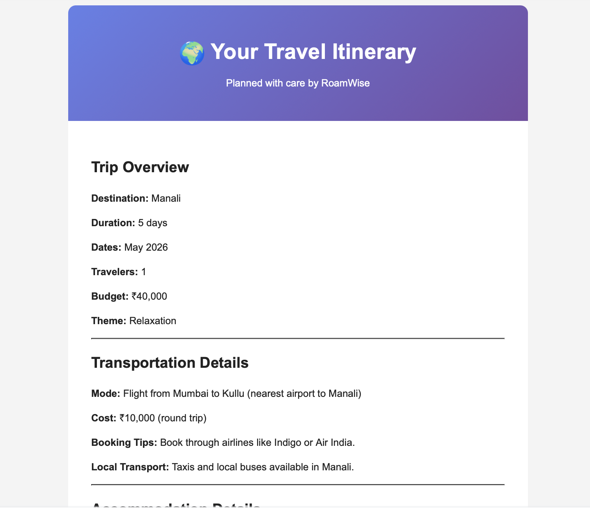

# 🌍 RoamWise


**RoamWise** is an intelligent travel planning application designed to enhance your exploration and make your journeys more seamless. Unlock the full potential of your travels with personalized recommendations, comprehensive itineraries, and convenient travel management tools powered by AI.

## 📖 Overview

Discover new destinations and hidden gems tailored to your preferences, interests, and travel style. RoamWise combines advanced algorithms with curated travel content to offer personalized recommendations that suit your individual tastes. Whether you're an adventure seeker, a food enthusiast, a history buff, or simply looking to unwind, RoamWise ensures your travel experiences align with your desires.

## ✨ Key Features

- **🗺️ Discover Destinations**: Find your perfect travel destination based on your preferences, interests, and travel style
- **📋 Itinerary Creation**: Create detailed, personalized itineraries by providing your destination, travel dates, and trip duration
- **📧 Email Itinerary**: Send your finalized itinerary directly to your email using Brevo email service
- **🏨 Hotel Recommendations**: Get smart hotel suggestions based on your budget and preferences
- **💰 Travel Budget Estimation**: Receive accurate travel budget approximations including hotel costs and airfare
- **🎯 Context-Based Recommendations**: Enjoy personalized travel recommendations tailored to your specific context and preferences
- **💬 Chat History**: Access your previous conversations and resume trip planning seamlessly with SQLite-based persistence
- **🤖 Agentic AI Architecture**: Multi-agent system with specialized agents working collaboratively to plan your perfect trip
- **👤 Human-in-the-Loop**: Interactive workflow where you confirm and approve recommendations at each step, ensuring full control over your travel plans

## 🏗️ Architecture

RoamWise is built using a modern, **agentic AI architecture** with **human-in-the-loop** design, powered by:

- **[OpenAI](https://openai.com/)**: Uses OpenAI's GPT models for intelligent travel planning and recommendations
- **[Chainlit](https://chainlit.io/)**: Interactive chat interface for seamless user experience
- **[LangGraph](https://langchain-ai.github.io/langgraph/)**: Orchestrates the multi-agent workflow with interrupts for human approval
- **[LangChain](https://www.langchain.com/)**: Foundation for LLM integration and prompt management

### Agentic Workflow with Human-in-the-Loop

RoamWise uses a sophisticated multi-agent system where specialized AI agents collaborate to plan your trip, while **you remain in control** at every step:

1. **Validator Agent**: Classifies user intent (travel, chit-chat, out-of-context) and handles follow-up questions
2. **Query Analyzer**: Extracts query type, trip type, and trip purpose
3. **Entity Identifier**: Collects and validates required travel entities (destination, dates, budget, etc.)
   - **→ Human Approval**: You confirm or modify the collected information
4. **Transport Agent**: Provides transportation recommendations and options
   - **→ Human Approval**: You review and approve transport suggestions
5. **Itinerary Planner**: Creates comprehensive travel itineraries
   - **→ Human Approval**: You review, modify, and approve the final itinerary

**Key Benefits of Human-in-the-Loop:**
- ✅ **Full Control**: You approve every major decision in your trip planning
- ✅ **Transparency**: See exactly what information the agents are using
- ✅ **Flexibility**: Modify recommendations at any stage
- ✅ **Trust**: No automated bookings without your explicit confirmation

### Email Itinerary Feature

Once your itinerary is finalized, you can receive it directly in your inbox:



The email includes your complete travel plan with all details, making it easy to access on the go.

## 🚀 Getting Started

### Prerequisites

- **Python 3.12** or higher
- **[uv](https://github.com/astral-sh/uv)** package manager
- **API Keys**: You must configure all required API keys before running the application (see `.env.sample` for the complete list)

### Installation

1. **Clone the repository**
   ```bash
   git clone https://github.com/sumanentc/travel-planner.git
   cd travel-planner
   ```

2. **Install dependencies using uv**
   ```bash
   uv sync
   ```

3. **Set up environment variables** ⚠️ **IMPORTANT**
   
   **All API keys must be configured before running the application.**
   
   Create a `.env` file in the project root:
   ```bash
   cp .env.sample .env
   ```
   
   **Check `.env.sample` for the complete list of required API keys.** At minimum, you need:
   
   ```env
   # Required
   OPENAI_API_KEY=your_openai_api_key_here
   
   # Required for email itinerary feature
   BREVO_API_KEY=your_brevo_api_key_here
   SENDER_EMAIL=your_email@example.com
   SENDER_NAME=YourName
   ```
   
   **API Key Setup:**
   - **OpenAI**: Sign up at [OpenAI](https://platform.openai.com/) and generate an API key
   - **Brevo (for email)**: Sign up at [Brevo](https://www.brevo.com/), verify your sender email, and generate an API key
   - See `.env.sample` for optional configuration keys (RETRIEVER, SCRAPER, etc.)

4. **Run the application**
   ```bash
   chainlit run app.py
   ```
   
   Or using Python directly:
   ```bash
   python app.py
   ```

5. **Access the application**
   
   Open your browser and navigate to:
   ```
   http://localhost:8000
   ```

## 📚 Usage

### Starting a New Trip

1. Launch the application
2. Choose from the starter prompts or type your own query
3. Follow the interactive conversation to provide trip details
4. Receive personalized recommendations and itineraries

### Example Queries

- "Plan a 5 day trip to Manali from Mumbai in May"
- "I want to plan a weekend getaway with my family"
- "Best places to visit in December in India"
- "Find hotels in Goa under ₹5000 per night"

### Resuming Previous Conversations

- Click the sidebar icon (☰) to view your chat history
- Select any previous conversation to continue where you left off
- All your trip planning context is preserved

## 🗂️ Project Structure

```
travel-planner/
├── agents/                    # Agent implementations
│   ├── validator.py           # Intent validation agent
│   ├── query_analyzer.py      # Query analysis agent
│   ├── entity_identifier.py   # Entity extraction agent
│   ├── transport.py           # Transport search agent
│   ├── accomodation.py        # Accommodation search agent
│   ├── itinerary.py           # Itinerary planning agent
│   ├── email_agent.py         # Email sending agent
│   ├── decision.py            # Decision routing agent
│   └── prompts.py             # System prompts for all agents
├── models/                    # Pydantic models
│   └── agent_models.py        # Data models for agents
├── tools/                     # Custom tools and utilities
│   └── custom_tools.py        # Web search, transport, accommodation tools
├── tests/                     # Test suite
├── images/                    # Application images and assets
├── .chainlit/                 # Chainlit configuration
│   └── config.toml            # App configuration
├── data/                      # Data storage for deep agents
├── public/                    # Public assets
├── app.py                     # Main Chainlit application
├── workflow.py                # LangGraph workflow definition
├── utils.py                   # Utility functions
├── chainlit.md                # Chainlit welcome screen
├── pyproject.toml             # Project dependencies (uv)
├── .env.sample                # Environment variables template
├── .gitignore                 # Git ignore rules
├── CHAT_HISTORY_SETUP.md      # Chat history configuration guide
└── README.md                  # This file
```

## 🔧 Configuration

### Chainlit Configuration

The application configuration is managed in `.chainlit/config.toml`. Key settings include:

- **Data Persistence**: SQLite-based chat history (enabled by default)
- **Session Timeout**: 15 days
- **UI Customization**: Theme, layout, and styling options

For detailed configuration options, see [CHAT_HISTORY_SETUP.md](CHAT_HISTORY_SETUP.md).

### Agent Prompts

All agent system prompts are centralized in `agents/prompts.py` for easy customization and maintenance.

## 🧪 Testing

Run the test suite:

```bash
# Run all tests
uv run pytest

# Run with coverage
uv run pytest --cov=agents --cov=models

# Run specific test file
uv run pytest tests/test_validator.py
```

## 📦 Dependencies

Core dependencies:

- `chainlit==2.9.1` - Interactive chat interface
- `langgraph==1.0.3` - Agent workflow orchestration
- `langchain==1.0.8` - LLM framework
- `langchain-openai==1.0.3` - OpenAI integration
- `gpt-researcher==0.14.5` - Research capabilities
- `deepagents==0.2.8` - Agent utilities

For the complete list, see [pyproject.toml](pyproject.toml).

## 🤝 Contributing

Contributions are welcome! Please follow these steps:

1. Fork the repository
2. Create a feature branch (`git checkout -b feature/amazing-feature`)
3. Commit your changes (`git commit -m 'Add amazing feature'`)
4. Push to the branch (`git push origin feature/amazing-feature`)
5. Open a Pull Request

## 📄 License

This project is licensed under the Apache License 2.0 - see the [LICENSE](LICENSE) file for details.

## 🙏 Acknowledgments

- Built with [Chainlit](https://chainlit.io/) for the interactive chat interface
- Powered by [LangGraph](https://langchain-ai.github.io/langgraph/) for agent orchestration
- Uses [LangChain](https://www.langchain.com/) for LLM integration

## 📞 Support

For questions, issues, or feature requests, please:

- Open an issue on GitHub
- Check the [documentation](CHAT_HISTORY_SETUP.md)
- Review existing issues and discussions

---

**Made with ❤️ by Suman Das**

*Simplifying travel planning, one journey at a time.*
